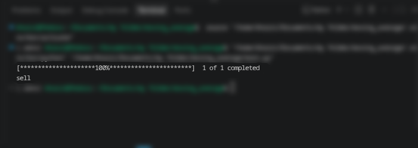

# Just simple moving average with custom symbols/changeable without opening the code

run the code and the code will tell you to input stocks Symbols

pure code no UI

```text
# Files Guide
portfolio/
├── custom/cache/location                # Library Location
├── LICENSE                              # LICENSE
├── README.MD                            # README
├── Screenshot-2026-11-03_21-05-47.png   # Documentation
└── main.py                              # Main File
```


